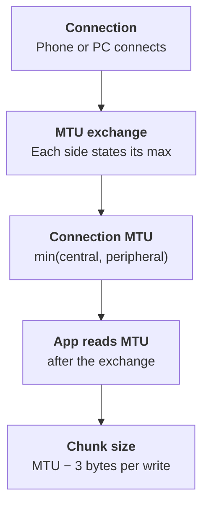

Your firmware can support a large ATT MTU, but the phone or laptop also sets a limit. The connection uses the smaller value of the two devices.

## Limits per platform

These are ATT MTU limits. The link-layer limit is 251 bytes on all of them.

| Platform | ATT MTU | Notes |
|---|---|---|
| Android 14 and later | 517 | The stack requests 517 on the first `requestMtu()` call and ignores later requests. Result is `min(517, peer MTU)`. |
| Android 13 and earlier | Up to 517 | The app requests a value with `requestMtu()`. |
| iPhone / iPad (iOS) | 185 on many devices, 527 seen on newer ones | iOS starts the exchange. The app cannot set it. Read it with `maximumWriteValueLength(for:)`. Values change with model and iOS version. |
| Mac (macOS) | Set by the OS | Same CoreBluetooth API as iOS. The app cannot set it. |
| Windows 10 / 11 | Set by the OS | Negotiated before the app gets the connection. Read it with `GattSession.MaxPduSize`. |
| Linux (BlueZ) | Up to 517 | `BT_ATT_MAX_LE_MTU` is 517 in BlueZ. |

## Rule for apps

Do not hard-code these numbers in an app. Read the negotiated value after the connection and size each write to `MTU - 3` bytes.

## Summary

- Phones and PCs cap the ATT MTU at about 517 bytes. iOS often uses 185.
- On iOS, macOS and Windows, the OS sets the MTU. The app can only read it.
- Read the MTU after connection, and send at most `MTU - 3` bytes per write.

## References

- [Android 14 behavior changes: ATT MTU 517](https://developer.android.com/about/versions/14/behavior-changes-all)
- [Apple Developer Forums: iOS MTU exchange](https://developer.apple.com/forums/thread/721541)
- [Nordic DevZone: iOS MTU 185 bytes](https://devzone.nordicsemi.com/f/nordic-q-a/44825/ios-mtu-size-why-only-185-bytes/176057)
- [Web Bluetooth discussion: MTU on Windows, macOS, Linux](https://lists.w3.org/Archives/Public/public-web-bluetooth-log/2020Feb/0004.html)
- [BlueZ att-types.h](https://coral.googlesource.com/bluez-imx/+/refs/tags/5.27/src/shared/att-types.h)

**Next:** [Part 4: Setting a large ATT MTU in Zephyr]()
