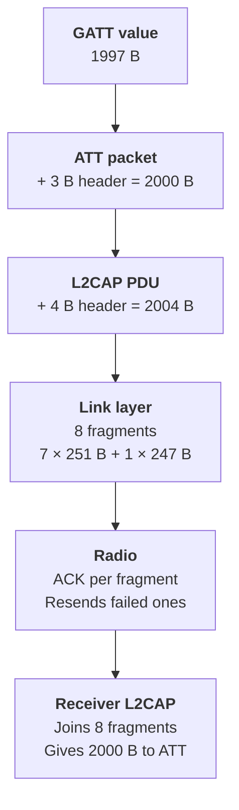

An ATT packet can be larger than one link-layer packet. L2CAP connects the two layers: it splits the ATT packet on the sender and joins it again on the receiver.



## L2CAP connects the two layers

If an ATT packet is larger than 251 bytes, L2CAP splits it into several link-layer packets. The receiver joins the fragments into the full ATT packet again.

L2CAP uses two terms for its data:

- **SDU (Service Data Unit):** the block that an upper layer gives to L2CAP. For GATT, one full ATT packet is one SDU.
- **PDU (Protocol Data Unit):** the SDU plus the 4-byte L2CAP header (2-byte length, 2-byte channel ID). ATT uses fixed channel 0x0004.

```
 ATT        [ ATT header (3 B) | value ]           <- L2CAP SDU
 L2CAP      [ L2CAP header (4 B) | SDU ]           <- L2CAP PDU
 Link layer [ frag 1 ][ frag 2 ] ... [ frag n ]    <- each <= 251 B
```

The L2CAP length field is 16 bits, so the format allows an SDU of up to 65535 bytes. The radio never sees the full SDU, only the fragments.

A 2000-byte ATT packet therefore goes over the air as about **eight** link-layer packets, usually in one connection event.

## Fragmentation does not lose data

The link layer acknowledges each packet and retransmits failed ones. A failed fragment adds latency but does not corrupt the message.

## Cost of large packets

- The radio stays on longer in each connection event, which uses more power.
- Both devices need more ACL buffer memory to hold the fragments.

## The spec ceiling: 512 bytes

The Bluetooth Core Specification, Vol 3, Part F, Section 3.2.9, limits an attribute value to **512 bytes**. A notification carries one attribute value, so a spec-compliant notification is at most 512 bytes.

This is why most stacks stop at an ATT MTU of **517 bytes**: 512 bytes of value plus the largest ATT header (5 bytes, for a Prepare Write). An MTU above 517 gives no benefit to a spec-compliant peer.

## Summary

- L2CAP splits one ATT packet into link-layer fragments of up to 251 bytes.
- The link layer ACKs each fragment, so fragmentation adds latency, not data loss.
- The spec limits an attribute value to 512 bytes, so most stacks stop at an MTU of 517 bytes.

## References

- [Zephyr l2cap.h: L2CAP header, RX/TX MTU macros](https://github.com/zephyrproject-rtos/zephyr/blob/main/include/zephyr/bluetooth/l2cap.h)

**Next:** [Part 3: ATT MTU on phones and laptops]()
