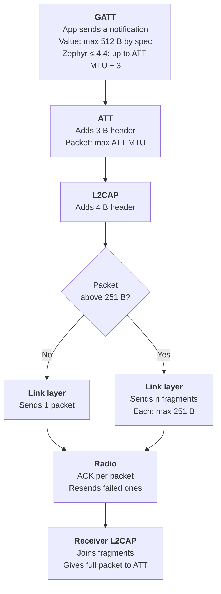
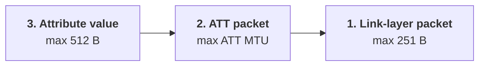

BLE has more than one packet size limit. Each limit applies to a different layer of the stack, so people often mix them up.

## The three limits at a glance

| # | Layer | Limit | Set by |
|---|---|---|---|
| 1 | Link layer payload | 27 B, or 251 B with DLE | Bluetooth Core Spec, same for every device |
| 2 | ATT packet | ATT MTU, 23 B default | MTU exchange at connection time |
| 3 | Attribute value | 512 B | Core Spec Vol 3, Part F, 3.2.9 |

## Other names for the same things

Datasheets, SDKs and forum posts use different words for these limits. Use this table to map a term to its layer.

| Layer | Other names you will see |
|---|---|
| Link layer payload | LL PDU payload, LL data length, maxTxOctets / maxRxOctets, Data Length Extension (DLE), "BLE packet size" |
| ATT packet | ATT_MTU, GATT MTU, "MTU", MaxPduSize (Windows), maximumWriteValueLength + 3 (Apple) |
| L2CAP | L2CAP SDU, segmentation and reassembly, fragmentation, ACL buffer size |
| Attribute value | Characteristic value length, GATT_MAX_ATTR_LEN, max attribute length |

When someone says "MTU" without a layer, they almost always mean the ATT MTU.

## Limit 1: Link layer

The link layer sends small packets. Each link-layer packet carries at most **27 bytes** of payload. With Data Length Extension (DLE), the limit increases to **251 bytes**.

This is the limit that people usually mean by "BLE packets are 27 to 251 bytes." It is the same for every device. No phone, laptop or chip sends a link-layer packet with more than 251 bytes of payload.

## Limit 2: ATT layer and MTU

The ATT layer sends larger packets. GATT notifications and writes travel as ATT packets. The **ATT MTU** sets the largest ATT packet that the two devices accept, and they agree on it at connection time. Each side states its maximum, and the connection uses the smaller value. The MTU is independent of the 251-byte link-layer limit.

## Limit 3: Attribute value

The Bluetooth Core Specification limits one attribute value to **512 bytes**. A notification carries one attribute value. [Part 2]() explains how this limit sets the common 517-byte MTU.

## Summary

> **"BLE is limited to 251 bytes."**
>
> 251 bytes is the link-layer packet size. A large MTU is at the ATT layer, and L2CAP splits each ATT packet across link-layer packets.

**Next:** [Part 2: How L2CAP fragments ATT packets]()
