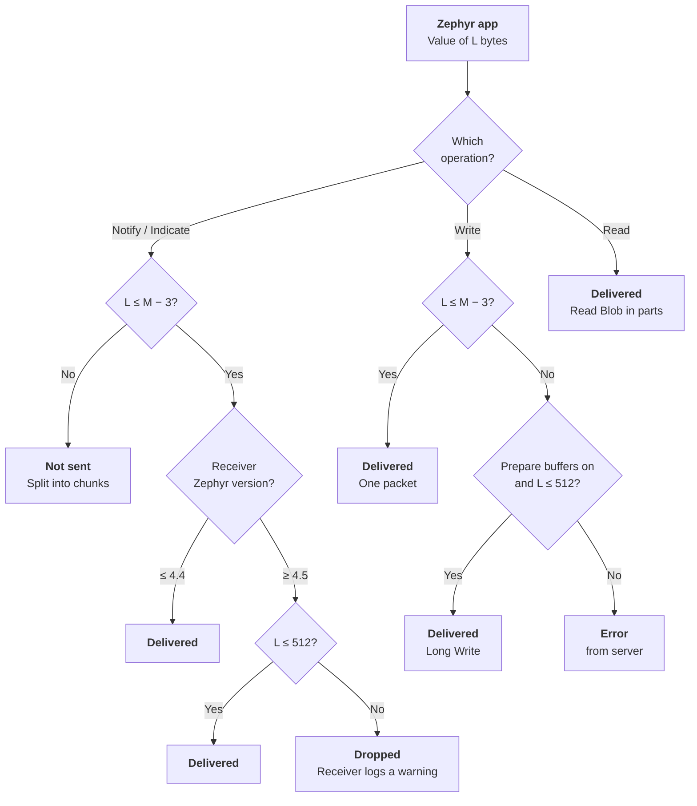

Two Zephyr devices can send a notification above the 512-byte spec limit. This post explains why, and gives the limit for each GATT operation.

## Why large notifications work between two Zephyr devices

- Both ends set a large MTU with the settings from [Part 4]().
- On the **send** side, Zephyr does not check the 512-byte attribute limit.
- On the **receive** side, Zephyr **4.4.x and earlier** accept values above 512 bytes. Zephyr **4.5 (from v4.5.0-rc1)** drops a received notification above 512 bytes and logs "Ignoring value with invalid length" (`gatt.c`).
- A phone or PC central caps the MTU at about 517 bytes. For those centrals, keep notifications at 512 bytes or less.

For large transfers that stay compliant and work on Zephyr 4.5, phones and PCs, use an **L2CAP connection-oriented channel (CoC)**. Its SDU can be up to 65535 bytes, and it has credit-based flow control.

## Limit per GATT operation

Reference for two nRF52840 boards (for example, Seeed Studio nRF52840 boards) that both run Zephyr. The board does not set these limits. The Zephyr Bluetooth stack sets them.

**M** is the connection ATT MTU: min(`CONFIG_BT_L2CAP_TX_MTU`, `CONFIG_BT_BUF_ACL_RX_SIZE` − 4), on the smaller of the two devices. `CONFIG_BT_L2CAP_TX_MTU` can be at most 2000.

| GATT operation | Spec limit | Zephyr 4.4 and earlier | Zephyr 4.5 and later | Notes |
|---|---|---|---|---|
| Notification / Indication | 512 B | M − 3 (max 1997 B) | 512 B (receiver drops larger values) | Value must fit in one ATT packet |
| Write (one packet) | 512 B | M − 3 | M − 3 | No 512 B check on the receiver in either version |
| Long Write (Prepare + Execute) | 512 B total | 512 B total | 512 B total | Used only when the value is above M − 3. Server needs `CONFIG_BT_ATT_PREPARE_COUNT` > 0 (default 0 = disabled). |
| Read (one packet) | 512 B | M − 1 | M − 1 | |
| Long Read (Read Blob) | 512 B total | Set by the server's read callback | Set by the server's read callback | Client reads parts until a response is shorter than M − 1. The stack has no 512 B check. |

With the example MTU of 1023, a notification can carry up to **1020 B** on Zephyr 4.4 and earlier, and up to **512 B** on Zephyr 4.5 and later.

To send more than these limits, split the data into chunks with a small header (sequence number, total length), or use an L2CAP CoC.

## Summary

- Zephyr 4.4 and earlier accept notifications up to M − 3 bytes, above the 512-byte spec limit.
- Zephyr 4.5 and later drop received notifications above 512 bytes.
- For large, compliant transfers, use chunks with a header or an L2CAP CoC.

## References

- [Zephyr gatt.c: 512-byte receive check](https://github.com/zephyrproject-rtos/zephyr/blob/main/subsys/bluetooth/host/gatt.c)
- [Zephyr att.c: Long Write reassembly limit](https://github.com/zephyrproject-rtos/zephyr/blob/main/subsys/bluetooth/host/att.c)
- [Zephyr Kconfig.gatt: BT_ATT_PREPARE_COUNT](https://github.com/zephyrproject-rtos/zephyr/blob/main/subsys/bluetooth/host/Kconfig.gatt)

**Back to start:** [Part 1: BLE packet sizes]()
