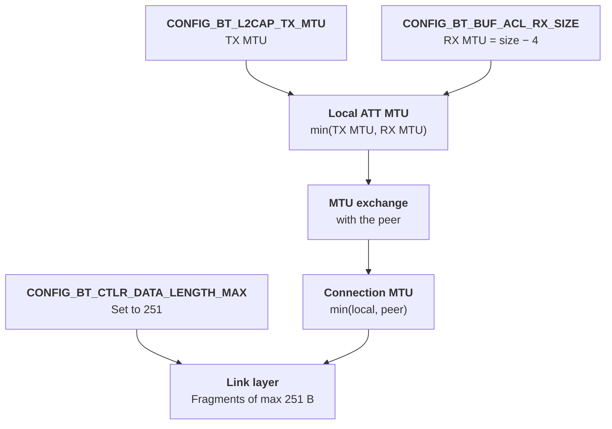

A large MTU is an **ATT** change. You also make the **L2CAP host buffer** large enough to hold it. The **link layer** stays at 251 bytes.

## Settings for a target MTU of N

For a target ATT MTU of **N** bytes, set:

| Setting | Value | Direction | What it controls |
|---|---|---|---|
| `CONFIG_BT_L2CAP_TX_MTU` | N | Send | Largest ATT packet this device sends |
| `CONFIG_BT_BUF_ACL_RX_SIZE` | N + 4 | Receive | Host buffer for one reassembled L2CAP PDU. RX MTU = this − 4 (L2CAP header). |
| `CONFIG_BT_BUF_ACL_TX_SIZE` | 251 | Host to controller | Size of one HCI ACL packet. Not the MTU. |
| `CONFIG_BT_CTLR_DATA_LENGTH_MAX` | 251 | Over the air | Link-layer payload (DLE). Cannot go above 251. |

Zephyr sends one value in the MTU exchange: the smaller of its TX MTU and RX MTU (`BT_LOCAL_ATT_MTU_UATT` in `att_internal.h`). The connection then uses the smaller of the two devices' values.

## Example: TX 1024, RX buffer 1027

| Step | Value |
|---|---|
| TX MTU | 1024 |
| RX MTU | 1027 − 4 = 1023 |
| Local ATT MTU | min(1024, 1023) = **1023** |
| Largest notification value | 1023 − 3 = **1020 bytes** |

The 4-byte L2CAP header makes the RX side one byte smaller than expected. To get a symmetric 1024, set `CONFIG_BT_BUF_ACL_RX_SIZE=1028`.

## Pitfall: DLE can silently stay at 27 bytes

`CONFIG_BT_CTLR_DATA_LENGTH_MAX` defaults to `CONFIG_BT_BUF_ACL_RX_SIZE` only when that value is 251 or less. Above 251, the default is **27**. With a large RX buffer, set `CONFIG_BT_CTLR_DATA_LENGTH_MAX=251` explicitly. If you do not, the large MTU still works, but each link-layer packet carries 27 bytes, and throughput drops.

## Limits

- `CONFIG_BT_L2CAP_TX_MTU` has a Kconfig range of 23 to 2000.
- Both devices must use the same large values. The connection uses the smaller one.

## Summary

- Set TX MTU to N and the RX ACL buffer to N + 4.
- Keep the HCI ACL TX size and the link-layer data length at 251.
- Always set `CONFIG_BT_CTLR_DATA_LENGTH_MAX=251` when the RX buffer is above 251.

## References

- [Zephyr l2cap.h: L2CAP header, RX/TX MTU macros](https://github.com/zephyrproject-rtos/zephyr/blob/main/include/zephyr/bluetooth/l2cap.h)
- [Zephyr att_internal.h: local ATT MTU](https://github.com/zephyrproject-rtos/zephyr/blob/main/subsys/bluetooth/host/att_internal.h)
- [Zephyr Kconfig.l2cap: TX MTU range](https://github.com/zephyrproject-rtos/zephyr/blob/main/subsys/bluetooth/host/Kconfig.l2cap)
- [Zephyr controller Kconfig: BT_CTLR_DATA_LENGTH_MAX default](https://github.com/zephyrproject-rtos/zephyr/blob/main/subsys/bluetooth/controller/Kconfig)

**Next:** [Part 5: Zephyr to Zephyr: GATT limits per operation]()
